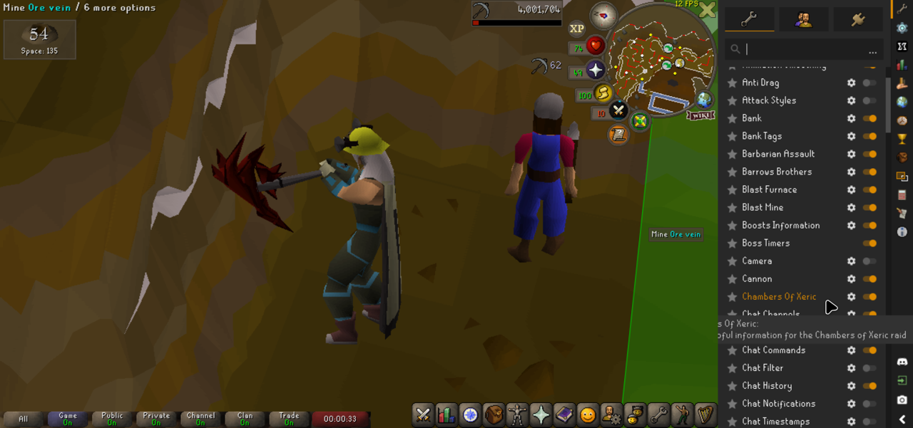
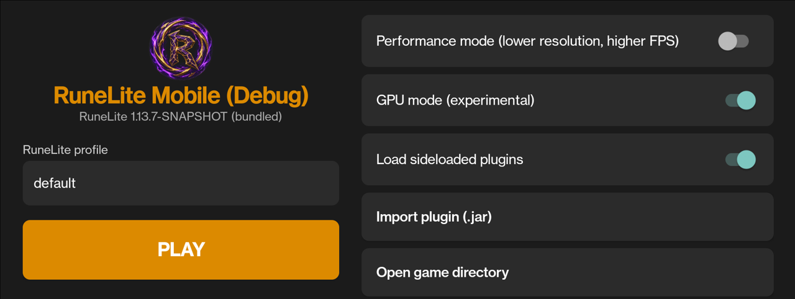
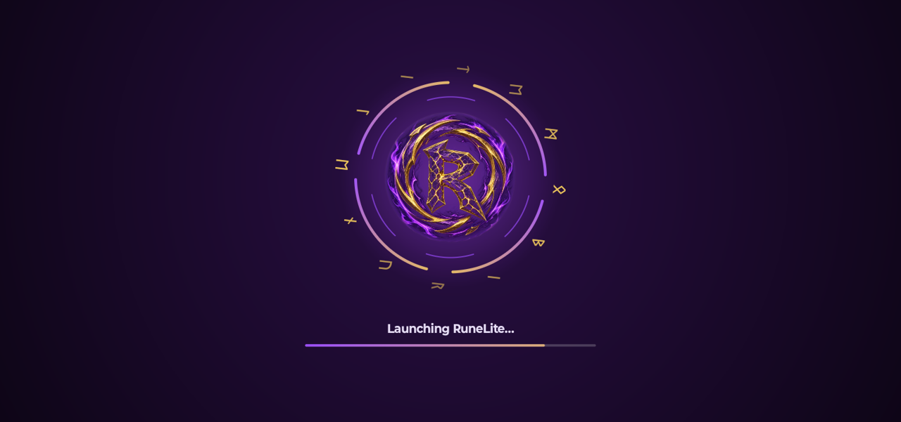
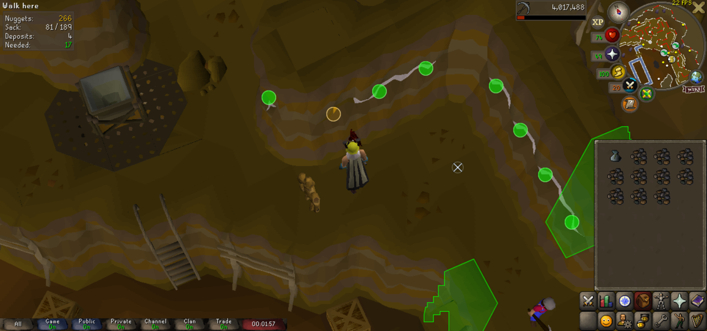
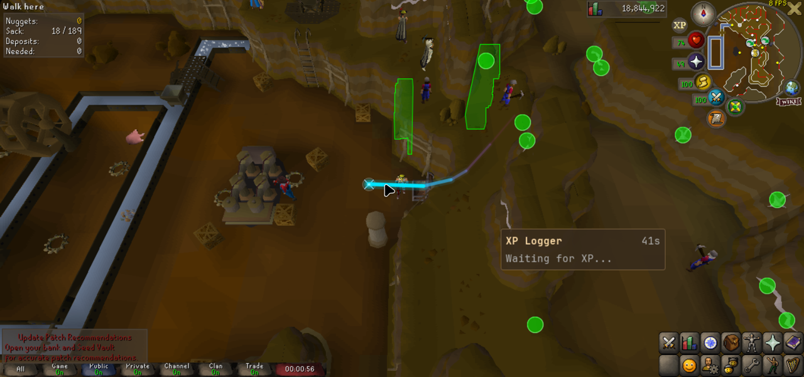
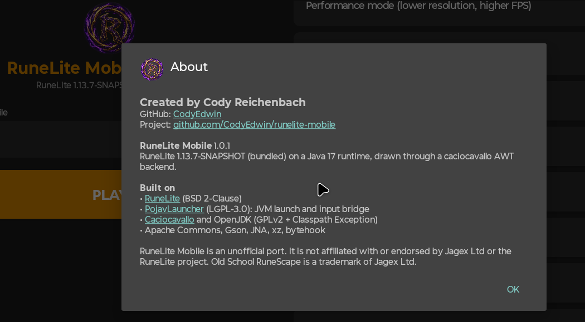

<p align="center"></p>

<h1 align="center">RuneLite Mobile</h1>

<p align="center">
The <a href="https://runelite.net">RuneLite</a> Old School RuneScape client running natively on Android phones and tablets,<br>
with GPU rendering, the Plugin Hub, sideloaded plugins and an optional custom RuneLite build.
</p>

<p align="center"></p>

RuneLite Mobile is a standalone Android app that runs the real desktop RuneLite client on a bundled
Java 17 runtime. It is built on PojavLauncher / Amethyst, stripped down and rebranded for RuneLite.
Package: `com.codyedwin.runelitemobile` (debug builds add `.debug`).

> Not affiliated with or endorsed by Jagex Ltd or the RuneLite project. Old School RuneScape is a
> trademark of Jagex Ltd.

## Features
- **The real RuneLite client**: your profiles, settings and plugins, with the Jagex account login
  done in an Android browser tab and the session kept across restarts.
- **GPU mode (experimental)**: RuneLite's GPU plugin running on OpenGL 4.6 translated to GLES 3.2 by
  [MobileGlues](https://github.com/MobileGL-Dev/MobileGlues).
- **117 HD support**: in GPU mode the 117 HD plugin is installed from the Plugin Hub automatically
  (once per profile). Only one renderer runs at a time, and if 117 HD fails it falls back to the
  stock GPU plugin.
- **Profile import/export**: *Import profile* / *Export profile* under the profile picker copy
  RuneLite `.properties` profiles in and out without opening RuneLite.
- **Plugin Hub**: browse and install Hub plugins in-game as on desktop.
- **Sideloaded plugins**: bundled plugin jars plus your own, imported with *Import plugin (.jar)*
  or shared to the app from a file manager. *Choose sideloaded plugins* opens a list where each one
  can be switched on or off individually; switched-off plugins are skipped on the next PLAY, nothing
  is deleted. A master *Load sideloaded plugins* toggle turns them all off.
- **Dev plugins folder with hot-reload**: jars in `/sdcard/RuneLite/plugins` load on every PLAY, in
  normal and custom mode. While the game runs, saving a new build of a jar there reloads its plugins
  in about 2 seconds, with no restart and no APK rebuild. Needs Android's "All files access"
  (*Dev plugins* button on the start screen).
- **.runelite folder**: *Open .runelite folder* opens RuneLite's settings/profiles folder directly
  (file managers hide it because of the leading dot).
- **Home screen widget and quick launch**: a *Play RuneLite* widget and a long-press *Play* app
  shortcut start the game straight away with your saved settings, or bring it back to the front if
  it is already running.
- **Sound**: game audio through Android.
- **Custom RuneLite**: *Use custom RuneLite (my plugins only)* launches the client built from
  [runelite-automation](https://github.com/CodyEdwin/runelite-automation) with only its plugins
  (rsbuddy incl. Android input, xplogger, fullscreen, currenthit, mouseeffects); no update check,
  regular sideloaded plugins are skipped. Refresh with `scripts/update_custom_runelite.sh`.
- **Battery overlay**: optional battery % at the top center, green/yellow/orange/red by level, blue with ⚡ while charging.
- **Touch lock shortcut**: a hardware-keyboard combo (default Ctrl+Shift+L, set in the launcher) blocks
  finger touches in game while mouse and keyboard keep working; press it again to unlock.
- **Update custom plugins without a new APK**: the launcher's **Update custom plugins** button downloads
  the newest jars from the [`custom-plugins`](https://github.com/CodyEdwin/runelite-mobile/releases/tag/custom-plugins)
  release into `/sdcard/RuneLite/custom-plugins`. In custom mode they replace the bundled jars of the same
  name and hot-reload within ~2 s while the game runs. Publish with `scripts/update_custom_runelite.sh`
  followed by `scripts/publish_custom_plugins.sh`.
- **Updater**: *RuneLite version & updates* keeps the client current from RuneLite's official
  bootstrap, with the bundled version as a fallback.
- **Render resolution**: a 25–100% slider (replaces Performance mode). Below 100% the game renders
  fewer pixels through RuneLite's Stretched Mode for higher FPS.
- **Touch Mode (OSRS mobile controls)**: optional. Tap clicks, one-finger drag rotates the camera,
  pinch zooms, hold opens the right-click menu, three fingers open the keyboard. Turn it off to drag
  inventory items and scrollbars.
- **FPS / temperature overlay**: optional readout of frames per second, battery and CPU temperature.
- **RSBuddy start/stop button**: with the custom client, an on-screen button presses RSBuddy's
  *Start/stop hotkey* (Pause): stops the running routine or restarts the last one.
- **View logs**: the latest log, RuneLite's `client.log` and crash files (`hs_err_pid*.log`) in-app,
  with Share and Copy.
- **Screen fit**: full screen, drawn over the camera cutout; kept clear of curved edges and visible
  system bars. *Pad game from rounded screen corners* moves the game in from rounded corners.
- **Release and debug builds**: each release has debug APKs (`.debug` package) and `-release` APKs
  (separate "RuneLite Mobile" app).
- Touch, mouse and keyboard input, landscape layout, and the game resizes correctly after switching apps.

## Install
1. Download the latest APK from [GitHub Releases](https://github.com/CodyEdwin/runelite-mobile/releases)
   (arm64 / `arm64-v8a` devices).
2. Open it on the phone and allow installing apps from that source when Android asks.
3. Start **RuneLite Mobile** and press **PLAY**. The first start unpacks the runtime and RuneLite,
   which takes a moment.

### Add the home screen widget
Long-press an empty spot on the home screen → **Widgets** → **RuneLite Mobile** → drag
**Play RuneLite** onto the home screen. Tap it to go straight into the game. You can also
long-press the app icon and choose **Play** (open the app once first so the shortcut is registered).

## Tested devices
| Device | GPU | Status |
| --- | --- | --- |
| OnePlus Nord N20 5G | Adreno 619 | Works; GPU mode (stock GPU plugin) ~25–40 FPS |
| Moto G Play 2026 | Mali-G57 MC2 | Works, including GPU mode |

Reports from other devices are welcome; open an issue with the log from *View logs* → Share.

## Screenshots
| | |
| --- | --- |
|  |  |
| Start screen: profile, PLAY, Performance / GPU mode and sideloaded plugin toggles | Loading screen |
|  |  |
| In game, GPU mode | In game with plugin overlays |
|  |  |
| RuneLite's plugin panel | About and credits |

## How it works
- A Java 17 runtime runs the desktop RuneLite client.
- Caciocavallo renders AWT/Swing into an off-screen buffer that a native blitter copies into an
  Android `TextureView`; touch, mouse and keyboard input is bridged back into AWT.
- In GPU mode, LWJGL loads OpenGL from `librlawt_android.so`, which renders offscreen through EGL
  with MobileGlues (GL 4.6 on GLES 3.2) and reads the frame back.
- `runelite_android_shim/` (put in front of RuneLite on the classpath) fits the window to the
  screen, fixes repaints/flicker, focus and popups, runs the Jagex login in an Android
  browser tab and keeps the Jagex session across restarts.

## Building
```
./gradlew :runelite:assembleDebug
```
The shim jar is rebuilt with `runelite_android_shim/build.sh`, the patched cacio classes with
`caciocavallo17_patches/build.sh`.

## Credits
Created by [Cody Reichenbach](https://github.com/CodyEdwin).

- [RuneLite](https://github.com/runelite/runelite) (BSD 2-Clause): the client itself
- [PojavLauncher](https://github.com/PojavLauncherTeam/PojavLauncher) / Amethyst / XDAetherium
  (LGPL-3.0): JVM launch and input bridge
- [MobileGlues](https://github.com/MobileGL-Dev/MobileGlues): OpenGL on GLES for GPU mode and 117 HD
- [Caciocavallo](https://github.com/PojavLauncherTeam/caciocavallo) and OpenJDK (GPLv2 + Classpath Exception)
- [117 HD](https://github.com/117HD/RLHD) plugin, installed from the RuneLite Plugin Hub
- Apache Commons, Gson, JNA, xz, bytehook

## License
Based on PojavLauncher / Amethyst / XDAetherium (LGPL-3.0); see `LICENSE`. The original
Minecraft launcher README is in `docs/README_XDAetherium_legacy.md`.
